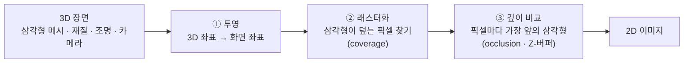
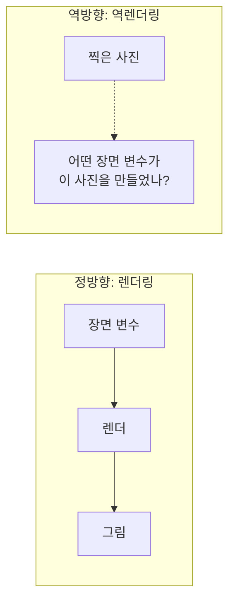
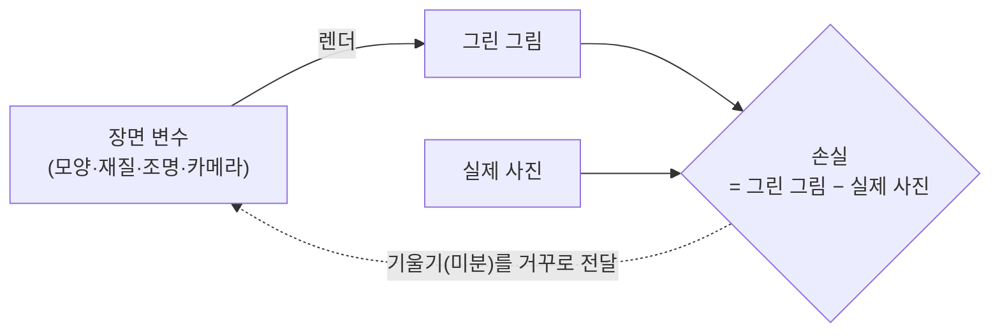
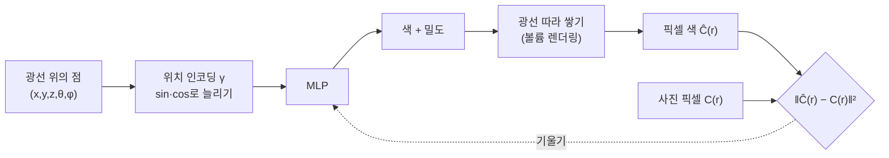
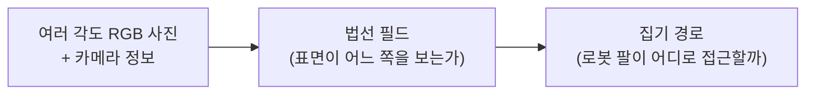
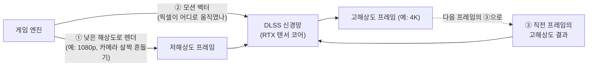

<a id="top"></a>

[미션](#brief) · [렌더링이란](#render) · [거꾸로 돌리기](#inverse) · [미분 가능](#diff) · [정답표 없이](#selfsup) · [DLSS](#dlss) · [한계](#limits) · [코드](#code) · [교육자 TIP](#teach)

**AI 렌더링 · 1 · 긴급 미션**

# 렌더링을 거꾸로 돌리면 — 정답표 없이 배우는 AI 렌더링

게임 속 세상은 3D인데 우리 모니터는 2D다. 컴퓨터는 매 순간 "3D 장면 → 2D 그림" 변환, 곧 **렌더링**을 한다. 이번 미션은 이 화살표를 뒤집는 것이다. 사진 몇 장만 주고 "이 사진을 만든 3D 장면을 알아내라"라고 하면, AI는 누가 정답표를 붙여 주지 않아도 **자기가 그린 그림과 실제 사진의 차이**만으로 배울 수 있다. 마지막에는 이 생각이 우리 그래픽카드 안에서 매일 돌아가는 기술, **DLSS**로 이어지는 것을 본다.

글 · 안상선 ((주)M-Robo 대표) · [저자 소개](#author)

| 숫자 | 뜻 |
|---|---|
| **5차원** | NeRF가 배우는 함수의 입력: 위치 x, y, z + 바라보는 방향 θ, φ |
| **0 → 0.000** | 사진 한 장으로 원의 위치·크기·밝기를 되찾은 손실 (코드 1, 부드러운 경계) |
| **0.091 → 0.091** | 경계가 딱딱하면 300걸음을 가도 손실이 그대로 (코드 1) |
| **16K** | DLSS 2.0이 학습 때 비교한 "정답 그림"의 해상도 (NVIDIA) |
| **23 → 39 dB** | 픽셀 복사 대비 "스스로 배운 업스케일러"의 화질 (코드 2) |
| **16 → 60 dB** | 움직이는 화면에서 모션 벡터를 쓰기 전과 후 (코드 2) |
| **2개** | Colab에서 바로 돌리는 코드 |

> **먼저 읽으면 좋은 편**
> 손실 함수와 경사 하강법(“숫자를 조금씩 고쳐 오차를 줄인다”)을 알면 섹션 4부터가 쉽다. 오토인코더(접었다 펼치기)는 [5-3 인코더·디코더](https://adminmrobo.github.io/motion_ai_series_01/5-3_encoder_decoder.html)에서 다룬다. DLSS 2.0의 신경망이 바로 이 구조다.

---

<a id="brief"></a>

## 1 · 미션 — "사진만 보고 3D를 알아내라"

> **[SYSTEM] 21:04** · 새 지령 수신. 첨부: 유리컵 다섯 개를 여러 각도에서 찍은 사진 한 묶음, 로봇 팔 한 대. 내용: "사진만 보고 컵의 3D 모양을 알아내 로봇이 집게 하라. 정답 3D 모델은 없음."

**박사** 정답 3D 모델이 없대! 사람이 컵 모양을 일일이 그려 줄 수도 없고. 그런데 우리한테는 무기가 하나 있지. 렌더링!

**조수** 렌더링은 3D를 2D로 그리는 거잖아요. 우리는 2D 사진에서 3D를 찾아야 하는데요? 방향이 반대예요.

**초파리 연구원** 그러니까 돌려 쓰는 거야. 3D를 대충 짐작해서 그려 본다 → 사진이랑 비교한다 → 틀린 만큼 3D를 고친다. 사진이 곧 채점표가 되는 거지.

**연구실 로봇** ^_^ 오늘의 장비: 삼각형 한 묶음, 부드러운 원 하나, 그리고 게임용 그래픽카드 속 AI(DLSS) 견학 일정을 준비했습니다.


*그림 1. 책상 위 유리컵 사진들이 화살표를 따라 "3D 짐작 → 다시 그리기 → 사진과 비교"의 고리를 도는 장면. 섹션 2~6에서 이 고리를 차례로 만든다.*

> **🖼 그림 명세 (fig01_mission)** 픽셀아트, 가로 16:9. 왼쪽에 카메라 여러 대가 둘러싼 유리컵 다섯 개, 가운데에 반투명한 3D 컵 와이어프레임, 오른쪽에 "다시 그린 사진"과 "실제 사진"이 나란히 있고 둘 사이에 빨간 "차이" 막대. 세 덩어리를 원형 화살표가 잇는다. 박사가 화살표를 가리키고, 조수는 고개를 갸웃.

---

<a id="render"></a>

## 2 · 렌더링이란 — 3D를 2D로 납작하게 만드는 일

### 2-1. 세 단계로 보는 렌더링



1. **투영(Projection)** — 3D 점을 화면 위 점으로 옮긴다. 멀리 있을수록 작게 보이게 하는 원근 투영, 크기를 그대로 두는 직교 투영이 있다.
2. **래스터화(Rasterization)** — 투영된 삼각형이 화면의 어느 픽셀을 덮는지 찾는다.
3. **깊이 처리** — 한 픽셀을 여러 삼각형이 덮으면, 카메라에 가장 가까운 것만 보인다. 픽셀마다 "지금까지 가장 가까운 거리"를 적어 두는 표를 **Z-버퍼**라 한다.

현대 GPU는 이 세 단계를 하드웨어로 아주 빠르게 처리한다.

### 2-2. 삼각형 가시성 — 렌더링이 매 픽셀 묻는 두 질문


*그림 2. 빨간 삼각형과 파란 삼각형이 겹친 화면, 검은 점 하나가 "표본(픽셀)"이다.*

> **🖼 그림 명세 (fig02_triangle_visibility)** SVG. 파란 삼각형 위에 빨간 삼각형이 일부 겹친다. 겹친 영역에 검은 점 하나와 "표본" 라벨. 오른쪽 위 말풍선 ① "이 점을 어떤 삼각형이 덮나? (coverage)", 오른쪽 아래 말풍선 ② "덮는 것 중 누가 가장 앞인가? (occlusion)". 강의 노트의 Triangle visibility 그림을 저자 스타일로 새로 그린다.

| 질문 | 이름 | 답을 구하는 방법 |
|---|---|---|
| ① 이 픽셀을 어떤 삼각형이 덮는가? | **커버리지(coverage)** | 래스터화 |
| ② 그중 카메라에 가장 가까운 것은? | **오클루전(occlusion)** | 깊이 비교(Z-버퍼) |

### 2-3. 왜 하필 삼각형인가

**조수** 세상에 동그란 것도 많은데, 왜 3D 모델은 전부 삼각형 조각이에요?

**박사** 점 세 개는 언제나 한 평면 위에 있거든! 네 점은 비틀릴 수 있지만 셋은 절대 안 비틀려.

| 이유 | 한 줄 풀이 |
|---|---|
| 항상 평평하다 | 세 점은 늘 한 평면 위에 있다 |
| 항상 볼록하다 | 안팎 판정이 간단해 래스터화 알고리즘이 단순해진다 |
| 무엇이든 근사한다 | 곡면도 작은 삼각형을 많이 쓰면 원하는 만큼 정밀해진다 |
| 내부 값 섞기가 쉽다 | 꼭짓점 세 개의 색·좌표를 무게중심 좌표로 섞으면 안쪽 어느 점의 값이든 나온다 |
| 잘게 쪼개기 쉽다 | 멀리 있으면 거칠게, 가까우면 촘촘하게(LOD) |
| 메모리가 적다 | 꼭짓점 세 개면 끝이다 |
| 하드웨어가 전문이다 | GPU는 삼각형 처리에 맞춰 설계되어 있다 |

사각형이나 더 복잡한 다각형을 쓰더라도 결국 그래픽카드 안에서는 삼각형으로 쪼개서 그린다.

#### 초보자를 위한 풀이

렌더링은 "**장면 변수 → 그림**"으로 가는 함수다. 장면 변수에는 모양(삼각형 꼭짓점 위치), 재질, 조명, 카메라 위치가 들어간다. 이 함수에 숫자를 넣으면 픽셀 수백만 개의 색이 나온다. 이번 편의 모든 이야기는 이 한 줄에서 시작한다.

```
그림 = 렌더(모양, 재질, 조명, 카메라)
```

---

<a id="inverse"></a>

## 3 · 거꾸로 돌리기 — 역렌더링(Inverse rendering)

### 3-1. 화살표를 뒤집는다



정방향은 쉽다. 장면만 정해 주면 그림은 계산으로 나온다. 역방향은 어렵다. 사진만 보고 장면 변수를 알아내야 한다.

**조수** 미분했던 걸 적분으로 되돌리는 거랑 비슷한 거 아니에요? 2차함수를 적분하면 3차함수가 나오잖아요.

**초파리 연구원** "되돌린다"는 점은 닮았어. 그런데 결정적으로 다른 데가 있어.

| 비교 | 적분 (2차 → 3차) | 역렌더링 (2D → 3D) |
|---|---|---|
| 답이 몇 개인가 | 상수 하나만 빼면 하나 | 같은 사진을 만드는 3D 장면이 **여러 개** |
| 정보 손실 | 거의 없음 (상수항뿐) | 3D → 2D에서 **깊이 정보가 사라짐** |
| 차원 | 그대로 | 2D에서 3D로 **늘려야** 함 |
| 푸는 방법 | 공식으로 바로 | **짐작하고 고치는 최적화**로 |

### 3-2. 한 장으로는 모자라는 이유


*그림 3. 핀홀 카메라 앞에 빨간 막대와 기울어진 파란 막대. 센서에는 색 칸만 찍히고, 두 막대가 얼마나 떨어져 있는지는 사라진다.*

> **🖼 그림 명세 (fig03_pinhole)** SVG, 가로형. 가운데 핀홀 카메라(점), 오른쪽에 빨간 세로 막대와 그 앞을 비스듬히 가로지르는 파란 막대, 왼쪽에 세로 칸 12개짜리 "가상 센서". 핀홀을 지나는 점선 광선이 각 막대 끝에서 센서로 이어지고, 센서 칸이 빨강/파랑으로 칠해진다. 아래에 작은 글씨 "센서에는 x/z만 남는다 — 깊이 z는 사라짐".

멀리 있는 큰 컵과 가까이 있는 작은 컵은 사진 한 장에서 똑같아 보일 수 있다. 그래서 역렌더링은 **여러 각도의 사진**을 쓴다. 각도를 바꿔 보면 가짜 답들이 하나씩 탈락한다.

#### 초보자를 위한 풀이

역렌더링은 "답을 공식으로 구한다"가 아니라 "**그럴듯한 답을 찾아 나선다**"에 가깝다. 장면을 짐작하고 → 그려 보고 → 사진과 비교하고 → 고친다. 이 고리를 수천 번 돈다. 그런데 "고친다"가 되려면 **어느 쪽으로 얼마나 고쳐야 하는지** 알아야 한다. 그것을 알려 주는 것이 미분이다. 다음 섹션의 주제다.

---

<a id="diff"></a>

## 4 · 미분 가능해야 거꾸로 갈 수 있다

### 4-1. 미분 가능한 렌더링이란


> **🖼 그림 명세 (fig04_diff_render_loop)** SVG. 왼쪽 노란 상자 넷(재질 · 조명 · 카메라 · 모양) → 회색 "렌더" 상자 → 파란 상자 넷(RGB · 깊이 · 실루엣 · 메타 이미지) → "목표 함수" → 초록 "정답 사진". 위쪽 화살표는 실선(정방향), 아래쪽 화살표는 점선으로 거꾸로 노란 상자까지 돌아온다(기울기). 아래 줄에 두 번째 고리: "사진 → 신경망 → 장면 변수 → 렌더 → RGB 이미지 → 처음 사진과 비교".



렌더링 과정 전체를 미분할 수 있게 만들면, "손실을 줄이려면 꼭짓점을 오른쪽으로 0.01 옮겨라" 같은 지시가 장면 변수까지 거꾸로 흘러간다. 이것이 **미분 가능한 렌더링(Differentiable rendering)** 이다.

### 4-2. 삼각형은 어디서 막히나

삼각형 렌더링으로 픽셀 하나의 색을 정하는 과정은 두 단계다.

1. **삼각형 고르기** — 모든 삼각형을 화면에 투영하고, 이 픽셀을 덮는 것 중 가장 가까운 하나를 고른다.
2. **색 계산** — 고른 삼각형의 꼭짓점 색을 섞어 픽셀 색을 만든다.

2단계는 부드러운 계산이라 미분이 잘 된다. 문제는 1단계다. 꼭짓점을 조금 옮겨도 픽셀이 여전히 같은 삼각형 안에 있으면 색이 그대로라 기울기가 0이다. 그러다 경계를 넘는 순간 색이 **뚝** 바뀐다. 강의 슬라이드의 "삼각형을 고른 **다음부터만** 미분 가능"이라는 말이 바로 이것이다.

### 4-3. 연속 함수 대 불연속 함수

| | 연속 함수 `sin(√(x²+y²))` | 불연속 함수 "원 안이면 1, 밖이면 0" |
|---|---|---|
| 모양 | 물결치듯 부드러운 언덕 | 원기둥처럼 수직으로 뚝 솟은 벽 |
| 위에서 보면 | 색이 서서히 변하는 동심원 | 경계가 계단처럼 깨진 원 |
| 미분 | 어디서나 기울기가 있다 | 벽 위에서 무한대, 나머지는 0 |
| 학습 | 어느 쪽으로 가야 할지 알 수 있다 | 길을 잃는다 |


*그림 5. 위: 연속 함수의 3D 표면과 위에서 본 모습. 아래: 불연속 함수(단위 원). 강의 노트의 matplotlib 그림을 그대로 다시 그리면 된다(코드는 용어 정리 C 아래 "그림 5 다시 그리기" 참고).*

> **비유 · 옛날 게임과 요즘 게임**
> 1992년 무렵의 1인칭 게임은 벽과 인물이 큼직한 네모 픽셀로 딱딱 끊어져 보였다. 같은 시리즈의 2014년 작품은 얼굴 피부와 빛이 부드럽게 이어진다. 강의 노트는 이것을 각각 "불연속"과 "연속"에 견주었다. 다만 이 비유에는 한계가 있다(섹션 D 비유 모음). 게임 화면이 부드러워 보이는 것과 렌더링을 미분할 수 있는 것은 같은 말이 아니다.

### 4-4. 직접 확인 — 사진 한 장으로 원 되찾기 (코드 1)

정답 원(위치 0.62, 0.40 · 반지름 0.22 · 밝기 0.90)을 그린 사진 한 장만 준다. AI는 엉뚱한 원(0.35, 0.60 · 0.12 · 0.40)에서 출발해 "그리기 → 비교 → 고치기"를 300번 한다. 원의 경계를 **부드럽게** 그릴 때와 **딱딱하게** 그릴 때를 비교했다.

| 학습 걸음 | 부드러운 경계: 손실 | 부드러운 경계: (cx, cy, r, 밝기) | 딱딱한 경계: 손실 | 딱딱한 경계: (cx, cy, r, 밝기) |
|---|---|---|---|---|
| **0** | 0.09218 | 0.350, 0.600, 0.120, 0.400 | 0.09577 | 0.350, 0.600, 0.120, 0.400 |
| **10** | 0.02798 | 0.552, 0.398, 0.238, 0.426 | 0.09184 | 0.350, 0.600, 0.120, 0.206 |
| **50** | 0.00050 | 0.611, 0.402, 0.224, 0.923 | 0.09097 | 0.350, 0.600, 0.120, 0.068 |
| **100** | 0.00000 | 0.619, 0.400, 0.220, 0.895 | 0.09097 | 0.350, 0.600, 0.120, 0.063 |
| **300** | 0.00000 | **0.620, 0.400, 0.220, 0.900** | 0.09097 | 0.350, 0.600, 0.120, 0.062 |

**박사** 봤지! 부드러운 쪽은 100걸음 만에 정답을 찾아갔어. 딱딱한 쪽은 위치랑 반지름이 처음 값 그대로야. 경계가 계단이라 "옮기면 좋아진다"는 신호 자체가 안 오거든.

**조수** 딱딱한 쪽은 밝기만 자꾸 낮췄네요. 원이 엉뚱한 데 있으니까 "차라리 안 보이게 하자"로 간 거예요?

**초파리 연구원** 정확해. 기울기가 오는 유일한 변수가 밝기라서 그쪽으로만 도망간 거야. 실제 미분 가능한 렌더러들(소프트 래스터라이저 [[R5]](#ref-softras), 신경 메시 렌더러 [[R4]](#ref-nmr))도 삼각형 경계를 이렇게 살짝 흐리게 만들어서 이 문제를 푼다.

---

<a id="selfsup"></a>

## 5 · 정답표 없이 배운다 — 사진 자체가 채점표

### 5-1. 그럼 이건 비지도 학습인가?

강의 때 나온 질문이다. 결론부터 말하면 **사람이 붙인 정답표(라벨)는 0개**다. 그런데 학습에는 분명한 채점 기준이 있다. 그래서 "비지도"보다는 **자기 지도 학습(self-supervised learning)** 이라고 부르는 것이 더 정확하다.

| | 지도 학습 | 비지도 학습 | **자기 지도 학습 (이번 편)** |
|---|---|---|---|
| 사람이 붙인 정답 | 필요 | 없음 | **없음** |
| 무엇을 맞히나 | 사람이 정한 이름표 | 정해진 답 없음 (묶기·패턴 찾기) | **데이터 자신** (찍은 사진을 다시 그려 내기) |
| 채점 기준 | 이름표와 일치 | 묶음의 응집도 등 | **다시 그린 그림 − 실제 사진** |
| 예 | 고양이/개 분류 | 고객 군집화 | Neural Volumes, NeRF, (넓게 보면) DLSS |

> **용어 주의** 블로그·강의에서는 "라벨 없이 배운다"는 뜻으로 넓게 "비지도"라고 부르기도 한다. 이 편의 제목도 그 넓은 뜻을 따랐다. 엄밀히 나누면 정답을 데이터 안에서 스스로 만들어 쓰는 자기 지도 학습이다.

### 5-2. Neural Volumes — 사진에서 3D 상자를 배운다


> **🖼 그림 명세 (fig06_neural_volumes)** SVG, 가로 4단. ① 사람 얼굴을 둘러싼 여러 대의 카메라 사진 → ② 깔때기 모양 인코더, 가운데 작은 잠재 벡터 z, 다시 넓어지는 디코더 → ③ 반투명 정육면체(3D 볼륨) 속을 지나는 광선과 그 위의 점들 → ④ 다시 그린 사진과 실제 사진, 사이에 "L2 차이". ④에서 ①로 돌아가는 화살표. 실제 인물 사진 대신 막대 인형 얼굴을 쓴다.

| 단계 | 하는 일 |
|---|---|
| ① 여러 각도 사진 | 같은 대상을 여러 카메라로 동시에 찍는다 |
| ② 인코더·디코더 | 사진을 작은 숫자 묶음으로 접었다가, 3D 볼륨으로 펼친다 |
| ③ 볼륨 표현 | 3D 공간의 점마다 RGB 색과 불투명도 α를 갖는다. 그래서 머리카락 같은 얇은 것, 반투명한 것도 표현된다 |
| ④ 광선 행진 | 카메라에서 광선을 쏘아 볼륨을 지나며 색과 불투명도를 쌓아 픽셀 하나를 만든다 |
| ⑤ 비교와 수정 | 다시 그린 사진과 실제 사진의 L2 차이를 줄이도록 전체를 한 번에 학습한다 |

불투명도 α가 0과 1 사이에 갇히지 않고 0부터 무한대까지 열려 있는 것도 요점이다. 덕분에 기울기가 막히지 않고 흘러간다 [[R2]](#ref-nv).

### 5-3. NeRF의 채점표 — 손실 함수 한 줄

NeRF는 3D 장면을 "위치 (x, y, z)와 보는 방향 (θ, φ)을 넣으면 색과 밀도가 나오는 **5차원 함수**"로 보고, 이 함수를 신경망으로 배운다 [[R1]](#ref-nerf). 채점은 다음 한 줄이다.

$$
\mathcal{L}=\sum_{r\in\mathcal{R}}\Big[\big\|\hat C_c(r)-C(r)\big\|_2^2+\big\|\hat C_f(r)-C(r)\big\|_2^2\Big]
$$

- r : 카메라에서 쏜 광선 하나 = 사진의 픽셀 하나
- C(r) : 실제 사진의 그 픽셀 색 ← **이것이 정답. 사람이 붙인 게 아니라 찍힌 사진 그 자체**
- Ĉ_c(r), Ĉ_f(r) : 거친(coarse) 네트워크와 세밀한(fine) 네트워크가 그린 색



**NeRF가 쓰는 두 가지 요령**

| 요령 | 왜 필요한가 | 한 줄 원리 |
|---|---|---|
| **위치 인코딩** | 신경망은 원래 부드러운(저주파) 모양부터 배우려는 버릇이 있어 잔무늬를 놓친다 | 좌표를 sin(2⁰πp), cos(2⁰πp), …, sin(2^{L−1}πp), cos(2^{L−1}πp)로 늘려 넣는다 [[R6]](#ref-fourier) |
| **계층적 샘플링** | 광선 위 모든 점을 촘촘히 보면 너무 느리다 | 거친 네트워크로 "물체가 있을 만한 곳"을 먼저 찾고, 그곳만 세밀한 네트워크로 촘촘히 본다 |

### 5-4. 레고로 다시 보기

**조수** 레고 더미를 쏟아 놓고 빨간 것끼리, 긴 것끼리 묶는 거랑 비슷한 거예요?

**박사** 그건 진짜 비지도 학습(군집화)이야. NeRF는 좀 달라. **완성된 레고 작품 사진이 여러 장** 있는 거야. 설명서는 없어. 조각을 이리저리 끼워 보고, 사진이랑 같은 각도에서 비교해서, 다른 데만 고쳐. 사진이 설명서 대신 채점을 해 주는 거지.

| NeRF 요소 | 레고 비유 |
|---|---|
| 손실 함수 | 내가 조립한 것을 사진과 같은 각도에서 찍어 비교하기 |
| 여러 각도 사진 | 앞에서만 맞추면 뒤가 엉망일 수 있으니 옆·뒤 사진으로도 확인 |
| 위치 인코딩 | "빨강"만이 아니라 "주황빛 도는 빨강"까지 구분하는 눈 |
| 계층적 샘플링 | 먼저 큰 덩어리를 대충 맞추고, 그다음 세부를 맞추기 |

### 5-5. 3D 가우시안 스플래팅 — 더 빠른 길

NeRF는 픽셀마다 광선 위의 점을 수십~수백 개 신경망에 물어봐야 해서 느리다. **3D 가우시안 스플래팅**은 장면을 "색과 크기, 방향을 가진 작은 반투명 타원(가우시안) 수십만 개"로 표현하고, 이것을 화면에 흩뿌리듯 그린다 [[R3]](#ref-3dgs). 채점 방식은 똑같이 "다시 그린 그림 − 실제 사진"이지만, 그리는 속도가 실시간 수준으로 빠르다.

### 5-6. 손실이 0에 가까우면 정답일까?


*그림 7. 강의 노트의 학습 손실 그래프. 손실이 처음 몇십 걸음에 뚝 떨어진 뒤 0.08 근처에서 출렁이며 평평해진다(세로축 로그 눈금).*

**조수** 손실이 바닥에 붙었으니 이제 정답이죠?

**초파리 연구원** 그렇다는 보장은 없어. 손실이 낮다는 건 "사진들과 잘 맞는다"는 뜻일 뿐이야.

| 함정 | 무슨 뜻 |
|---|---|
| 지역 최소값 | 더 깊은 골짜기가 있는데 근처 작은 웅덩이에 갇힘 |
| 평평한 지대 | 기울기가 거의 0이라 학습이 멈춘 것처럼 보임 |
| 과적합 | 학습에 쓴 각도는 완벽한데 새 각도에서 보면 엉망 |
| 채점표의 한계 | 픽셀 제곱 오차가 작아도 사람 눈에는 흐릿해 보일 수 있음 |
| 같은 사진, 다른 3D | 섹션 3의 "답이 여러 개" 문제가 그대로 남음 |

대책으로는 여러 번 다른 출발점에서 학습하기, 정규화(볼륨이 지나치게 흩어지지 않게 등), 학습률 조절, 더 나은 손실 함수 설계가 쓰인다. 결과는 반드시 학습에 쓰지 않은 각도에서 확인한다.

### 5-7. 미션 결과 — 투명한 유리컵

유리컵은 렌더링에서 가장 까다로운 손님이다. 뒤가 비쳐 보이고, 빛이 휘고, 깊이 센서도 제대로 못 잰다. 그래서 투명 물체 전용 데이터셋이 쓰인다. ClearPose는 투명 물체 사진 약 35만 장에 깊이·마스크·법선·카메라 위치를 함께 담았다 [[R7]](#ref-clearpose). 이런 자료로 법선(표면 방향)과 마스크를 먼저 미리 배워 두고, 실제 현장에서는 다음 순서로 간다.




> **🖼 그림 명세 (fig08_transparent_grasp)** 픽셀아트, 가로 3단. ① 로봇 팔 두 대 아래 유리 플라스크 다섯 개 ② 같은 플라스크가 무지갯빛 법선 색으로 칠해진 3D 덩어리 ③ 회색 3D 모양 사이로 초록 막대(집기 경로)가 뻗어 있음. 하단에 연구실 로봇이 엄지를 든다.

---

<a id="dlss"></a>

## 6 · DLSS — 적게 그리고, AI로 채운다

### 6-1. 게임의 고민: 4K로 그리기엔 너무 무겁다

4K 화면은 픽셀이 약 830만 개다. 1080p(약 207만 개)의 네 배다. 광선 추적까지 켜면 그래픽카드가 버티지 못한다. 엔비디아가 2019년 내놓은 **DLSS(Deep Learning Super Sampling)** 의 생각은 단순하다. **적은 픽셀만 진짜로 그리고, 나머지는 AI가 채운다.** NVIDIA는 DLSS 2.0이 픽셀의 4분의 1에서 절반만 렌더링하고도 원래 해상도에 견줄 화질을 낸다고 설명한다 [[R8]](#ref-dlss2).



### 6-2. DLSS는 무엇을 보고 배웠나 — 정답도 렌더링이 만든다

NVIDIA 설명에 따르면 DLSS 2.0 신경망의 학습은 이렇게 돌아간다 [[R8]](#ref-dlss2) [[R9]](#ref-dlss-june21).

1. 슈퍼컴퓨터에서 게임 장면을 **16K 초고해상도로 오프라인 렌더링**해 정답 그림을 만든다.
2. 같은 장면을 낮은 해상도로 그리고, 모션 벡터와 함께 신경망에 넣어 고해상도로 키운다.
3. 키운 결과를 16K 정답과 비교해 차이만큼 신경망을 고친다. 이것을 수만 번 되풀이한다.
4. 다 배운 신경망은 드라이버 업데이트로 사용자 그래픽카드에 배달된다.

**조수** 어, 그럼 DLSS는 정답이 있으니까 지도 학습 아니에요?

**박사** 날카롭네! 정답과 비교한다는 점에서는 지도 학습 모양이야. 그런데 그 정답을 **사람이 붙인 게 아니라 렌더러가 더 열심히 그려서 만든 것**이지. NeRF가 "찍힌 사진"을 정답으로 쓰듯, DLSS는 "더 비싸게 그린 그림"을 정답으로 써. 둘 다 사람 손 없이 렌더링이 스스로 채점표를 만든다는 공통점이 있어.

**초파리 연구원** 엄밀히 말하면 DLSS는 "렌더러가 만든 정답으로 하는 지도 학습"이야. 이 편에서 DLSS를 데려온 이유는 **"정답표를 사람이 아니라 렌더링이 만든다"** 는 같은 뿌리를 보여 주기 위해서야.

| | NeRF (섹션 5) | DLSS 2.0 |
|---|---|---|
| 입력 | 여러 각도 사진 + 카메라 위치 | 저해상도 프레임 + 모션 벡터 + 이전 결과 |
| 정답 | 찍힌 사진 그 자체 | 16K로 비싸게 렌더링한 그림 |
| 사람 라벨 | 없음 | 없음 |
| 배우는 것 | 한 장면의 3D 구조 | 여러 게임에 두루 통하는 "업스케일 요령" |
| 언제 학습하나 | 장면마다 새로 | 미리 한 번(일반화 네트워크), 사용자 PC는 추론만 |

### 6-3. 시간이 도와준다 — 지터와 모션 벡터

DLSS 2.0의 핵심 재료는 "시간"이다 [[R9]](#ref-dlss-june21).

- **지터(jitter)** : 프레임마다 카메라를 픽셀 반 칸 정도씩 살짝 흔들어 그린다. 그러면 연속된 프레임들이 같은 픽셀의 **서로 다른 자리**를 찍게 된다. 몇 프레임을 모으면 한 장으로는 못 얻는 세부가 생긴다(시간적 슈퍼샘플링).
- **모션 벡터** : 화면이 움직이면 이전 프레임의 정보를 그대로 겹칠 수 없다. 게임 엔진이 "이 픽셀은 오른쪽으로 2칸 갔다"는 화살표를 알려 주면, 이전 정보를 그 자리로 옮겨서 쓸 수 있다.
- **시간 피드백** : 직전 프레임의 고해상도 결과를 다음 프레임의 재료로 다시 넣는다. 과거로 미래를 돕는 셈이다.


> **🖼 그림 명세 (fig09_jitter_motion)** SVG, 위아래 두 줄. 윗줄: 2×2 고해상도 칸 네 개 중 프레임 1~4가 각각 다른 칸(왼위, 오위, 왼아래, 오아래)에 점을 찍고, 오른쪽에 네 점이 모여 꽉 찬 2×2 칸. 아랫줄: 같은 과정인데 물체(공)가 오른쪽으로 이동해서, 왼쪽 "모션 벡터 없음"은 공이 네 겹으로 번진 잔상, 오른쪽 "모션 벡터 사용"은 화살표로 옮겨 붙인 뒤 선명한 공 하나.

### 6-4. 직접 확인 — 작은 DLSS 흉내 (코드 2)

64×64 "고해상도 장면" 200장을 렌더링한 뒤, 스스로 32×32로 줄였다가 다시 키우는 법을 배우게 했다. 사람이 붙인 라벨은 하나도 없다. 정답은 줄이기 전의 고해상도 렌더링 자신이다. 처음 보는 장면 50장으로 시험했다.

| 방법 | 평균 PSNR (dB, 높을수록 원본과 같음) |
|---|---|
| 가장 가까운 픽셀 복사 (AI 없음) | 23.03 |
| **배운 업스케일러, 1장만 보고** | **38.61** |
| 지터 4장 합치기 · 화면이 멈춰 있을 때 | 60.00 (상한, 사실상 원본과 같음) |
| 지터 4장 · 화면이 움직이는데 **모션 벡터 없이** | 16.34 |
| 지터 4장 · 화면이 움직이고 **모션 벡터 사용** | 60.00 (상한) |

**조수** 모션 벡터 없이 겹치면 그냥 복사(23 dB)보다도 나빠지네요!

**초파리 연구원** 그게 고스팅(잔상)이야. 움직인 물체를 옛날 자리에 겹쳐 버리니까. DLSS 1.0이 움직이는 장면에서 고생했고, 2.0이 모션 벡터를 받아 쓰면서 크게 좋아진 이유가 이거야 [[R10]](#ref-anand).

> **이 코드가 단순화한 것** 코드 2의 업스케일러는 신경망이 아니라 "주변 3×3 픽셀 → 2×2 픽셀"을 잇는 선형 필터를 최소제곱으로 푼 것이다. 실제 DLSS 2.0은 합성곱 오토인코더를, DLSS 4부터는 트랜스포머를 쓴다. 또 코드는 움직임이 정확히 짝수 픽셀이라 지터 4장이 완벽하게 맞아떨어지지만, 실제 게임은 움직임이 불규칙하고 가려졌다 드러나는 부분이 있어 AI가 판단해야 할 몫이 훨씬 크다.

### 6-5. DLSS는 어떻게 자라 왔나

| 버전 | 시기 | 무엇이 달라졌나 |
|---|---|---|
| **1.0** | 2019 | 게임마다 따로 학습. 64배 슈퍼샘플링 정답으로 학습했으나 움직임에 약함 [[R10]](#ref-anand) |
| **2.0** | 2020.3 | 게임과 무관한 **일반화 네트워크** + 모션 벡터 + 시간 피드백, 16K 정답으로 학습 [[R8]](#ref-dlss2) |
| **3** | 2022 | **프레임 생성**: 렌더링한 두 장 사이에 AI가 한 장을 더 만든다 (RTX 40) |
| **3.5** | 2023 | **광선 재구성**: 광선 추적 노이즈 제거기 여러 개를 AI 모델 하나로 바꿈 |
| **4** | 2025.1 | CNN 대신 **트랜스포머**, 렌더링 한 장당 최대 3장을 만드는 **다중 프레임 생성** (RTX 50) [[R11]](#ref-dlss4) |
| **4.5** | 2026 | 2세대 트랜스포머, 상황 따라 배수를 바꾸는 동적 다중 프레임 생성, 최대 6배 모드 [[R12]](#ref-dlss45) |

**연구실 로봇** ^_^ 참고: 엔비디아에 따르면 2025년 1월 기준 DLSS 지원 게임·앱은 540개가 넘습니다. 2025년 6월 발매된 닌텐도 스위치 2는 DLSS를 쓰는 첫 게임기입니다.

#### 초보자를 위한 풀이

DLSS 안에는 사실 서로 다른 문제를 푸는 AI가 여럿 들어 있다. **슈퍼 해상도**는 "작게 그린 그림을 크게", **프레임 생성**은 "두 장 사이에 한 장 더", **광선 재구성**은 "광선 추적의 지글거림 지우기"다. 모두 "비싸게 그린 정답과 비교하며 배운 AI가, 싸게 그린 그림을 비싼 그림처럼 보이게 만든다"는 공통점이 있다.

---

<a id="limits"></a>

## 7 · 한계 — 그리고 다음 미션

| 한계 | 어디서 드러나나 | 왜 |
|---|---|---|
| 같은 사진, 다른 3D | 역렌더링 전반 | 3D → 2D에서 깊이 정보가 사라진다. 각도가 적으면 가짜 답이 남는다 |
| 경계에서 기울기가 끊긴다 | 삼각형 렌더러 (코드 1의 딱딱한 경계) | 가시성 판정이 불연속이라 위치·크기 신호가 오지 않는다 |
| 고치기 어렵다 | NeRF·Neural Volumes | 장면이 신경망 가중치 안에 녹아 있어 "이 컵만 옮기기" 같은 편집이 어렵다 (강의 노트: "뉴럴 네트워크는 수정이 어렵다") |
| 잔상(고스팅) | DLSS | 모션 벡터가 틀리거나 없는 곳(연기, 반투명, 화면 UI)에서 이전 프레임이 남는다 |
| 만든 프레임은 입력을 모른다 | DLSS 프레임 생성 | 화면은 부드러워져도, 게임 로직과 입력 반응까지 그만큼 빨라지지는 않는다 |
| 투명 물체 | 유리컵 미션 | 빛이 휘고 비쳐서 "보이는 색 = 표면 색"이라는 가정이 깨진다 |

이 편에서 알게 된 것

- **렌더링은 함수다.** 장면 변수를 넣으면 그림이 나온다. 삼각형을 투영하고, 덮는 픽셀을 찾고, 가장 앞의 것만 남긴다.
- **거꾸로 가려면 미분이 필요하다.** 경계를 부드럽게 하면 사진 한 장으로도 원을 정확히 되찾는다(손실 0.092 → 0.000). 딱딱하면 제자리다.
- **사진이 채점표다.** NeRF와 Neural Volumes는 사람 라벨 없이 "다시 그린 그림 − 실제 사진"만으로 3D를 배운다.
- **DLSS도 같은 뿌리다.** 정답을 사람 대신 비싼 렌더링이 만들고, 시간(지터·모션 벡터)이 부족한 픽셀을 채운다.

남은 문제

- **편집할 수 있는 3D:** 신경망 속에 녹은 장면을 다시 삼각형이나 가우시안처럼 손으로 고칠 수 있는 형태로 꺼내기.
- **실시간:** NeRF의 질을 DLSS의 속도로. 가우시안 스플래팅과 신경 렌더링이 만나는 지점이 다음 미션이다.

**박사** 유리컵 모양은 찾았어. 다음은 이걸 게임처럼 실시간으로 돌리는 거야!

**조수** 사진 찍는 건 또 제 담당이죠? 컵 다섯 개를 360도로…

**초파리 연구원** 이번엔 수백 장이면 돼. 다음 편에서는 가우시안 수십만 개로 같은 장면을 1초에 수십 번 그려 볼 거야.

---

<a id="code"></a>

## A · Colab 코드 — 이 페이지를 직접 실행해 보기

두 코드 모두 Colab에 기본으로 설치된 numpy만 쓴다. 새 노트북 칸에 붙여 넣고 실행한다.

**코드 1 · 사진 한 장으로 장면 되찾기 — 부드러운 경계 대 딱딱한 경계** · 섹션 4와 연결 · numpy · CPU 약 3초

원 하나(위치·반지름·밝기)를 정답으로 그린 사진에서, 엉뚱한 원으로 출발해 "그리기 → 비교 → 고치기"를 300번 한다. **내 데이터로 바꾸려면** `render` 함수에 원 대신 사각형이나 원 두 개를 그리게 하고 `true_p`를 늘린다.

```python
# 코드 1 · 사진 한 장만 보고 장면을 되찾기 — 미분 가능한 렌더링(역렌더링)
import numpy as np
np.random.seed(0)
N = 32
ys, xs = np.mgrid[0:N, 0:N] / (N - 1)          # 화면 픽셀 좌표 0~1

def render(p, soft=True, tau=0.03):
    """장면 변수 p = [cx, cy, r, 밝기] → 32x32 이미지"""
    cx, cy, r, c = p
    d = np.sqrt((xs - cx)**2 + (ys - cy)**2)
    if soft:   # 경계를 부드럽게: 연속 함수 → 미분 가능
        cover = 1 / (1 + np.exp(-np.clip((r - d) / tau, -50, 50)))
    else:      # 안이면 1, 밖이면 0: 불연속 함수 → 미분 0
        cover = (d < r).astype(float)
    return c * cover

def loss(p, target, soft):
    return np.mean((render(p, soft) - target) ** 2)

def grad(p, target, soft, h=1e-4):          # 수치 미분
    g = np.zeros(4)
    for i in range(4):
        e = np.zeros(4); e[i] = h
        g[i] = (loss(p + e, target, soft) - loss(p - e, target, soft)) / (2 * h)
    return g

true_p  = np.array([0.62, 0.40, 0.22, 0.90])   # 정답 장면 (모델은 모른다)
target  = render(true_p, soft=True)             # 우리가 가진 것은 이 사진 한 장뿐
start_p = np.array([0.35, 0.60, 0.12, 0.40])   # 아무렇게나 시작

for soft in (True, False):
    p = start_p.copy(); lr = 0.02; m = np.zeros(4); v = np.zeros(4)
    print(f"\n[{'부드러운 경계(연속)' if soft else '딱딱한 경계(불연속)'}]")
    for step in range(301):
        if step in (0, 10, 50, 100, 300):
            print(f"걸음 {step:3d} | 손실 {loss(p, target, soft):.5f} | "
                  f"cx {p[0]:.3f} cy {p[1]:.3f} r {p[2]:.3f} 밝기 {p[3]:.3f}")
        g = grad(p, target, soft)            # Adam: 걸음 크기를 알아서 조절
        m = 0.9*m + 0.1*g; v = 0.999*v + 0.001*g*g
        p -= lr * (m/(1-0.9**(step+1))) / (np.sqrt(v/(1-0.999**(step+1))) + 1e-8)
print("\n정답       | cx 0.620 cy 0.400 r 0.220 밝기 0.900")
```

실행 결과 (2026-10-31 실행, numpy · CPU). 시드를 고정해 언제 실행해도 같다.

```text
[부드러운 경계(연속)]
걸음   0 | 손실 0.09218 | cx 0.350 cy 0.600 r 0.120 밝기 0.400
걸음  10 | 손실 0.02798 | cx 0.552 cy 0.398 r 0.238 밝기 0.426
걸음  50 | 손실 0.00050 | cx 0.611 cy 0.402 r 0.224 밝기 0.923
걸음 100 | 손실 0.00000 | cx 0.619 cy 0.400 r 0.220 밝기 0.895
걸음 300 | 손실 0.00000 | cx 0.620 cy 0.400 r 0.220 밝기 0.900

[딱딱한 경계(불연속)]
걸음   0 | 손실 0.09577 | cx 0.350 cy 0.600 r 0.120 밝기 0.400
걸음  10 | 손실 0.09184 | cx 0.350 cy 0.600 r 0.120 밝기 0.206
걸음  50 | 손실 0.09097 | cx 0.350 cy 0.600 r 0.120 밝기 0.068
걸음 100 | 손실 0.09097 | cx 0.350 cy 0.600 r 0.120 밝기 0.063
걸음 300 | 손실 0.09097 | cx 0.350 cy 0.600 r 0.120 밝기 0.062

정답       | cx 0.620 cy 0.400 r 0.220 밝기 0.900
```

**코드 2 · 작은 DLSS 흉내 — 렌더링이 만든 정답으로 배우는 업스케일러와 모션 벡터** · 섹션 6과 연결 · numpy · CPU 약 5초

고해상도 장면을 스스로 줄였다 키우는 법을 배우고, 지터 4장을 합칠 때 모션 벡터가 있고 없음을 비교한다. 섹션 6-4의 표가 이 출력에서 바로 만들어진다.

```python
# 코드 2 · 작은 DLSS 흉내 — 정답 이름표 없이 "고해상도 렌더링 자신"을 정답으로 배운다
import numpy as np
np.seterr(divide="ignore")
rng = np.random.default_rng(0)
H = 64                                            # 고해상도 64x64, 저해상도 32x32

def scene(k=6):
    """무작위 원과 줄무늬가 섞인 장면을 고해상도로 '렌더링'한다"""
    ys, xs = np.mgrid[0:H, 0:H] / H
    img = np.zeros((H, H))
    for _ in range(k):
        cx, cy, r = rng.random(), rng.random(), 0.05 + 0.2 * rng.random()
        img += rng.random() / (1 + np.exp(-(r - np.hypot(xs - cx, ys - cy)) / 0.01))
    img += 0.3 * np.sin(2 * np.pi * (rng.integers(3, 9)) * (xs * rng.random() + ys))
    return (img - img.min()) / (np.ptp(img) + 1e-9)

def low(img, dx=0, dy=0):                         # 픽셀 4개 중 하나만 찍기(지터 dx,dy)
    return img[dy::2, dx::2]

def psnr(a, b):
    return 10 * np.log10(1 / np.mean((a - b) ** 2))

def patches(lo):                                  # 저해상도 픽셀마다 주변 3x3 조각
    p = np.pad(lo, 1, mode="edge")
    return np.stack([p[i:i+lo.shape[0], j:j+lo.shape[1]].ravel()
                     for i in range(3) for j in range(3)], 1)

def blocks(hi):                                   # 고해상도 2x2 블록 = 맞혀야 할 정답
    return np.stack([hi[i::2, j::2].ravel() for i in range(2) for j in range(2)], 1)

def assemble(b):
    out = np.zeros((H, H)); n = H // 2
    for k, (i, j) in enumerate([(0,0),(0,1),(1,0),(1,1)]):
        out[i::2, j::2] = b[:, k].reshape(n, n)
    return out

# ① 학습: 고해상도 렌더링 200장을 스스로 줄이고, 다시 키우는 법을 배운다 (사람 라벨 0개)
train = [scene() for _ in range(200)]
X = np.vstack([np.c_[patches(low(s)), np.ones(32*32)] for s in train])
Y = np.vstack([blocks(s) for s in train])
W = np.linalg.lstsq(X, Y, rcond=None)[0]          # 9칸+1 → 4칸 '업스케일 필터'

# ② 시험: 처음 보는 장면 50장
test = [scene() for _ in range(50)]
res = {"가장 가까운 픽셀 복사": [], "배운 업스케일러(1장)": [],
       "지터 4장 합치기 · 멈춘 화면": [], "지터 4장 · 움직임, 모션 벡터 없음": [],
       "지터 4장 · 움직임, 모션 벡터 사용": []}
for s in test:
    lo = low(s)
    res["가장 가까운 픽셀 복사"].append(psnr(np.kron(lo, np.ones((2, 2))), s))
    res["배운 업스케일러(1장)"].append(psnr(assemble(np.c_[patches(lo), np.ones(32*32)] @ W), s))
    acc = np.zeros((H, H))                        # 프레임마다 카메라를 반 픽셀씩 흔든다
    for dy in (0, 1):
        for dx in (0, 1):
            acc[dy::2, dx::2] = low(s, dx, dy)
    res["지터 4장 합치기 · 멈춘 화면"].append(min(psnr(acc, s), 60.0))
    # 화면이 프레임마다 오른쪽으로 2픽셀씩 움직이면? (마지막 프레임 t=3이 '지금')
    now = np.roll(s, 6, axis=1)
    bad = np.zeros((H, H)); good = np.zeros((H, H))
    for t, (dy, dx) in enumerate([(0,0),(0,1),(1,0),(1,1)]):
        frame = np.roll(s, 2 * t, axis=1)          # t번째 프레임의 고해상도 장면
        bad[dy::2, dx::2] = low(frame, dx, dy)      # 그냥 겹치면 잔상(고스팅)
        moved = np.zeros((H, H)); moved[dy::2, dx::2] = 1
        tmp = np.zeros((H, H)); tmp[dy::2, dx::2] = low(frame, dx, dy)
        sh = 2 * (3 - t)                            # 모션 벡터: '지금'까지 더 갈 거리
        good = np.where(np.roll(moved, sh, axis=1) > 0, np.roll(tmp, sh, axis=1), good)
    res["지터 4장 · 움직임, 모션 벡터 없음"].append(psnr(bad, now))
    res["지터 4장 · 움직임, 모션 벡터 사용"].append(min(psnr(good, now), 60.0))

print("시험 장면 50장 평균 PSNR (높을수록 원본과 같음, dB)")
for k, v in res.items():
    print(f"  {k:26s} {np.mean(v):6.2f}")
```

실행 결과 (2026-10-31 실행, numpy · CPU). 60.00은 원본과 완전히 같아 상한으로 자른 값이다.

```text
시험 장면 50장 평균 PSNR (높을수록 원본과 같음, dB)
  가장 가까운 픽셀 복사                23.03
  배운 업스케일러(1장)                38.61
  지터 4장 합치기 · 멈춘 화면           60.00
  지터 4장 · 움직임, 모션 벡터 없음       16.34
  지터 4장 · 움직임, 모션 벡터 사용       60.00
```

**그림 5 다시 그리기 (선택)** · 강의 노트의 연속/불연속 그림

```python
import numpy as np, matplotlib.pyplot as plt
x = y = np.linspace(-3, 3, 200); X, Y = np.meshgrid(x, y)
funcs = {"Continuous": np.sin(np.sqrt(X**2 + Y**2)),
         "Discontinuous": (X**2 + Y**2 < 1).astype(float)}
fig = plt.figure(figsize=(11, 9))
for k, (name, Z) in enumerate(funcs.items()):
    ax = fig.add_subplot(2, 2, 2*k + 1, projection="3d")
    ax.plot_surface(X, Y, Z, cmap="viridis"); ax.set_title(f"3D View: {name}")
    ax2 = fig.add_subplot(2, 2, 2*k + 2)
    im = ax2.imshow(Z, extent=[-3, 3, -3, 3], origin="lower", cmap="viridis")
    ax2.set_title(f"2D View: {name}"); fig.colorbar(im, ax=ax2)
plt.tight_layout(); plt.show()
```

---

## B · AI 응용 프롬프트 — 이 코드를 출발점으로 삼기

ChatGPT, Qwen, Claude 같은 AI 도우미에 붙여 넣는다. 〔 〕 안을 내 상황으로 바꾼다. 프롬프트 뒤에 코드 1이나 코드 2를 함께 붙인다.

```text
나는 〔대학생 / 게임 개발 입문자 / 제조 현장 엔지니어〕다.
아래 코드는 "그린 그림 − 실제 사진"의 차이만으로 장면 변수를 찾는 미분 가능한 렌더링 예제다.
1) 이 코드를 〔원 두 개 / 사각형 / 3D 구 하나를 두 각도에서 본 사진 두 장〕으로 확장해 줘.
2) 딱딱한 경계에서 학습이 멈추는 이유를 기울기 값을 출력해 보여 줘.
3) 바꾼 코드의 실행 결과를 표로 정리하고, 학습이 실패하는 출발점도 하나 찾아 줘.
〔코드 붙이기〕
```

```text
아래 코드는 DLSS를 흉내 낸 작은 업스케일러다.
1) 선형 필터 대신 numpy만으로 은닉층 하나짜리 신경망을 써서 PSNR이 오르는지 비교해 줘.
2) 움직임을 〔홀수 픽셀 / 반 픽셀 / 물체마다 다른 방향〕으로 바꾸면 모션 벡터 방식이 어디서 깨지는지 보여 줘.
3) 실제 DLSS 2.0과 이 코드의 차이를 세 줄로 정리하고, 근거는 NVIDIA 공식 문서 링크로 달아 줘.
〔코드 붙이기〕
```

AI의 답은 출발점일 뿐이다. 제안된 논문·수치·버전 정보는 반드시 원문과 공식 문서로 확인한다. DLSS처럼 빠르게 바뀌는 제품은 특히 그렇다.

---

## C · 용어 정리

| 용어 | 뜻 | 처음 나온 곳 |
|---|---|---|
| **렌더링** | 3D 장면 변수(모양·재질·조명·카메라)를 2D 이미지로 바꾸는 계산 | [섹션 2](#render) |
| **투영** | 3D 좌표를 화면 좌표로 옮기기. 원근 투영·직교 투영 | 섹션 2-1 |
| **래스터화** | 투영된 삼각형이 덮는 픽셀을 찾는 과정 | 섹션 2-1 |
| **Z-버퍼** | 픽셀마다 가장 가까운 물체의 거리를 적어 두는 표 | 섹션 2-1 |
| **커버리지 / 오클루전** | 픽셀을 덮는 삼각형 찾기 / 그중 가장 앞의 것 고르기 | 섹션 2-2 |
| **무게중심 좌표** | 삼각형 안의 점을 세 꼭짓점의 가중 평균으로 나타내는 좌표 | 섹션 2-3 |
| **LOD** | 거리에 따라 메시의 세밀함을 바꾸는 기법 | 섹션 2-3 |
| **역렌더링** | 이미지에서 그것을 만든 장면 변수를 추정하는 일 | [섹션 3](#inverse) |
| **미분 가능한 렌더링** | 렌더링 전체를 미분할 수 있게 만들어, 손실의 기울기를 장면 변수까지 보내는 기술 | [섹션 4](#diff) |
| **자기 지도 학습** | 사람 라벨 없이 데이터 자신에서 정답을 만들어 배우는 방식 | [섹션 5](#selfsup) |
| **볼륨 렌더링 / 광선 행진** | 광선을 따라 점들의 색과 불투명도를 쌓아 픽셀 색을 만드는 방법 | 섹션 5-2 |
| **NeRF** | 장면을 (위치, 방향) → (색, 밀도) 5차원 함수로 표현해 신경망으로 배우는 방법 | 섹션 5-3 |
| **위치 인코딩** | 좌표를 여러 주파수의 sin·cos로 늘려 신경망이 잔무늬를 배우게 하는 요령 | 섹션 5-3 |
| **계층적 샘플링** | 거친 네트워크로 중요한 곳을 찾고 그곳만 촘촘히 보는 방법 | 섹션 5-3 |
| **3D 가우시안 스플래팅** | 장면을 작은 반투명 타원 수십만 개로 표현해 빠르게 그리는 방법 | 섹션 5-5 |
| **법선** | 표면이 바라보는 방향을 나타내는 화살표 | 섹션 5-7 |
| **DLSS** | 낮은 해상도로 그린 뒤 AI로 고해상도·추가 프레임을 만드는 NVIDIA 기술 | [섹션 6](#dlss) |
| **지터** | 프레임마다 카메라를 픽셀 이하만큼 흔들어 다른 자리를 찍게 하는 것 | 섹션 6-3 |
| **모션 벡터** | 픽셀이 이전 프레임에서 어디로 움직였는지 나타내는 화살표 | 섹션 6-3 |
| **고스팅** | 이전 프레임의 정보가 엉뚱한 자리에 남아 생기는 잔상 | 섹션 6-4 |
| **PSNR** | 두 이미지가 얼마나 같은지 나타내는 값(dB). 높을수록 같다 | 섹션 6-4 |
| **텐서 코어** | 행렬 계산을 빠르게 하는 NVIDIA RTX GPU 안의 AI 전용 연산 장치 | 섹션 6-1 |

---

## D · 비유 모음 — 그리고 비유가 틀리는 지점

비유는 이해의 첫걸음이지만 오해의 씨앗도 된다. 사람의 지각과 견준 비유에는 강도를 표시했다. **직접** 실제로 같은 일을 한다는 근거가 있음 · **부분** 일부 성질만 닮음 · **없음** 대응하는 것이 알려지지 않음

| 개념 | 일상 비유 | 사람의 지각 비유 | 비유가 틀리는 지점 |
|---|---|---|---|
| **렌더링** | 그림자놀이: 손 모양(3D)이 벽에 그림자(2D)를 만든다 | **부분** 눈의 망막도 3D 세상을 2D 상으로 받는다 | 그림자는 색과 재질을 잃지만, 렌더링은 색·빛·재질까지 계산한다 |
| **역렌더링** | 그림자만 보고 손 모양 맞히기 | **부분** 사람은 두 눈과 고개 움직임으로 깊이를 짐작한다 | 사람은 "컵은 보통 이렇게 생겼다"는 상식을 쓰지만, NeRF는 그 장면 사진만으로 배운다 |
| **적분과 역렌더링** | 미분한 걸 적분으로 되돌리기 | 없음 | 적분은 답이 사실상 하나지만, 역렌더링은 같은 사진을 만드는 답이 여럿이다 |
| **연속/불연속** | 옛날 네모 픽셀 게임 대 요즘 부드러운 게임 | 없음 | 화면이 부드러워 보이는 것과 계산이 미분 가능한 것은 다르다. 요즘 게임도 삼각형 경계 판정은 여전히 딱딱하다 |
| **자기 지도 학습** | 설명서 없이 완성 사진만 보고 레고 조립 | **부분** 아이가 블록을 쌓고 "그림이랑 같나" 비교하며 배우는 것 | 아이는 몇 번이면 감을 잡지만, NeRF는 장면 하나에 수만 번 고쳐야 한다 |
| **위치 인코딩** | 색을 "빨강" 대신 "주황빛 도는 빨강"까지 나누는 눈 | 없음 | 실제로는 색 구분이 아니라 좌표를 여러 주파수 물결로 늘리는 수학 장치다 |
| **DLSS** | 스케치를 대충 그리고 숙련된 화가가 마무리 | 없음 | 화가는 상상으로 채우지만, DLSS 2.0은 지터·모션 벡터로 이전 프레임의 진짜 정보를 모아 채우는 몫이 크다 |
| **모션 벡터** | 여러 장 겹쳐 찍은 사진에서 움직인 사람을 제자리로 옮겨 붙이기 | **부분** 눈이 움직이는 물체를 따라가며 보는 것 | 투명한 것, 연기, 화면 글자는 "어디로 갔는지"가 분명치 않아 화살표가 틀린다 |

---

<a id="author"></a>

## E · 저자 소개와 레퍼런스

E-1 저자 소개 · E-2 학술 레퍼런스 · E-3 그림과 숫자의 출처

### E-1 저자 소개

**안상선** ((주)M-Robo 대표)

한국전기안전공사, 매일경제신문을 거쳐 현재 매일경제 사외벤처 (주)M-Robo를 창업해 대표로 재직하고 있다. (주)M-Robo는 언론사 사내 벤처로 시작한 미디어 벤처로, 국민일보에 로봇기자(스톡봇)을 서비스 했으며, 한국인터넷진흥원, 한국언론진흥재단, 한국방송통신전파진흥원 등에서 다수의 프로젝트를 진행했다. 이후 자체 A.I 뉴스 신문인 Money-Robo를 서비스 중이다. 대표 재직 중 아시아오픈 데이터 해커톤 우승, 데이터창업 분야 공로로 행정안전부 장관상을 2회 수상했으며, 인공지능 및 블록체인 분야에 대한 5개 특허 발명 및 등록자이다. 저서로는 "AI범죄와 자기방어"가 있으며, 핀테크분야, 통계학, 인공지능 분야에 대해서 한국기술교육대학교 온라인평생교육원 이러닝 콘텐츠 개발을 진행했다. 최종학위는 경제학 박사(동국대, 미시수리경제학)이다. 국민대학교, 호서대학교 등 여러 대학교에서 데이터 및 인공지능과 관련한 과목을 강의하고 있다. [자세한 프로필](https://ahnboat.xyz/2023/01/29/my_profile/)

### E-2 학술 레퍼런스

1. <a id="ref-nerf"></a>[R1] Mildenhall, B., Srinivasan, P. P., Tancik, M., Barron, J. T., Ramamoorthi, R., & Ng, R. (2020). NeRF: Representing scenes as neural radiance fields for view synthesis. *ECCV 2020*. [arXiv:2003.08934](https://arxiv.org/abs/2003.08934) — 섹션 5-3
2. <a id="ref-nv"></a>[R2] Lombardi, S., Simon, T., Saragih, J., Schwartz, G., Lehrmann, A., & Sheikh, Y. (2019). Neural volumes: Learning dynamic renderable volumes from images. *ACM TOG (SIGGRAPH 2019)*. [arXiv:1906.07751](https://arxiv.org/abs/1906.07751) — 섹션 5-2
3. <a id="ref-3dgs"></a>[R3] Kerbl, B., Kopanas, G., Leimkühler, T., & Drettakis, G. (2023). 3D Gaussian splatting for real-time radiance field rendering. *ACM TOG (SIGGRAPH 2023)*. [arXiv:2308.04079](https://arxiv.org/abs/2308.04079) — 섹션 5-5
4. <a id="ref-nmr"></a>[R4] Kato, H., Ushiku, Y., & Harada, T. (2018). Neural 3D mesh renderer. *CVPR 2018*. [arXiv:1711.07566](https://arxiv.org/abs/1711.07566) — 섹션 4
5. <a id="ref-softras"></a>[R5] Liu, S., Li, T., Chen, W., & Li, H. (2019). Soft rasterizer: A differentiable renderer for image-based 3D reasoning. *ICCV 2019*. [arXiv:1904.01786](https://arxiv.org/abs/1904.01786) — 섹션 4
6. <a id="ref-fourier"></a>[R6] Tancik, M., Srinivasan, P. P., Mildenhall, B., et al. (2020). Fourier features let networks learn high frequency functions in low dimensional domains. *NeurIPS 2020*. [arXiv:2006.10739](https://arxiv.org/abs/2006.10739) — 섹션 5-3
7. <a id="ref-clearpose"></a>[R7] Chen, X., Zhang, H., Yu, Z., Opipari, A., & Jenkins, O. C. (2022). ClearPose: Large-scale transparent object dataset and benchmark. *ECCV 2022*. [arXiv:2203.03890](https://arxiv.org/abs/2203.03890) — 섹션 5-7
8. <a id="ref-dlss2"></a>[R8] NVIDIA (2020.3.23). NVIDIA DLSS 2.0: A big leap in AI rendering. [nvidia.com](https://www.nvidia.com/en-us/geforce/news/nvidia-dlss-2-0-a-big-leap-in-ai-rendering/) — 섹션 6-1, 6-2
9. <a id="ref-dlss-june21"></a>[R9] NVIDIA (2021.6). NVIDIA DLSS: Coming to Rust, DOOM Eternal, LEGO Builder's Journey and more this month (DLSS 작동 원리 설명 포함). [nvidia.com](https://www.nvidia.com/en-us/geforce/news/june-2021-rtx-dlss-game-update/) — 섹션 6-2, 6-3
10. <a id="ref-anand"></a>[R10] Smith, R. (2020.3.23). NVIDIA intros DLSS 2.0: Ditches per-game training, adds motion vectors for better quality. *AnandTech*. [anandtech.com/show/15648](https://www.anandtech.com/show/15648) — 섹션 6-4, 6-5
11. <a id="ref-dlss4"></a>[R11] NVIDIA Research (2025). Technical insights into DLSS 4: Multi frame generation and transformer-based architectures. [research.nvidia.com/labs/adlr/DLSS4](https://research.nvidia.com/labs/adlr/DLSS4) — 섹션 6-5
12. <a id="ref-dlss45"></a>[R12] NVIDIA Developer. NVIDIA DLSS (DLSS 4.5 개요). [developer.nvidia.com/rtx/ray-tracing/dlss/get-started](https://developer.nvidia.com/rtx/ray-tracing/dlss/get-started) — 섹션 6-5
13. Wikipedia contributors. Deep Learning Super Sampling. [en.wikipedia.org/wiki/Deep_Learning_Super_Sampling](https://en.wikipedia.org/wiki/Deep_Learning_Super_Sampling) — 섹션 6 전반의 배경 참고 (게시 전 최신 내용 재확인 필요)

### E-3 그림과 숫자의 출처

- 섹션 2~5의 개념 구성과 질문(왜 삼각형인가, 적분과 무엇이 다른가, 라벨링은 어떻게 하나, 비지도인가 자기 지도인가, 손실 최소값이 정답을 보장하나)은 저자의 강의 노트(2024.10.17 2차)에서 왔다
- 그림 1·8은 저자가 새로 그릴 픽셀아트, 그림 2·3·4·6·9는 강의 슬라이드의 구조를 따라 새로 그릴 SVG다. 게임 화면 캡처와 실제 인물 사진은 쓰지 않는다
- 그림 5·7은 강의 노트에 실린 matplotlib 그림이다 (그림 5는 섹션 A의 코드로 다시 그릴 수 있다)
- 섹션 4-4와 6-4의 표는 코드 1·2를 실제로 실행한 결과다. 장면은 모두 합성 데이터다
- DLSS의 버전·학습 방식·지원 게임 수는 NVIDIA 공식 발표와 위 레퍼런스를 따랐다. 제품 정보는 빠르게 바뀌므로 게시일 기준으로 다시 확인한다

---

<a id="teach"></a>

## F · 교육자를 위한 TIP

강사, 실무 OJT 담당자, 튜터를 위한 운영 안내다. 시간은 예상치이므로 실제 수업에 맞춰 조정한다.

| 항목 | 내용 |
|---|---|
| 대상 | 3D 그래픽스·컴퓨터 비전 입문 대학생, 게임·디지털 트윈·로봇 비전 실무자 |
| 선수 지식 | 함수와 미분의 뜻, 손실 함수와 경사 하강법의 아이디어 |
| 학습 목표 | ① 렌더링을 "장면 변수 → 이미지" 함수로 설명하고 커버리지·오클루전을 구분한다 ② 미분 가능성이 역렌더링에 왜 필요한지 코드 1로 보인다 ③ NeRF 손실 함수에서 "정답"이 무엇인지 말하고 지도·비지도·자기 지도를 구분한다 ④ DLSS가 지터·모션 벡터·렌더링 정답으로 화질을 채우는 원리를 설명한다 |
| 예상 시간 | 읽기 40~50분 · 토론 20분 · Colab 실습 25분 (코드 1 10분, 코드 2 15분) |

### 운영안 세 가지

**강의형 50분 · 개념 중심**
도입 5분(섹션 1) → 섹션 2 렌더링 10분 → 섹션 3 역렌더링 7분 → 섹션 4 연속/불연속과 코드 1 표 10분 → 섹션 5 NeRF 손실 함수 10분 → 섹션 6 DLSS 8분.

**실무 OJT 90분 · 게임·비전 실무 중심**
섹션 2·4 20분 → 코드 1 실행하고 tau 값을 0.003, 0.1로 바꿔 보기 20분 → 섹션 6 DLSS와 코드 2 25분 → "우리 현장 카메라 데이터로 NeRF/가우시안 스플래팅을 쓰면?" 팀 토론 15분 → 정리 10분.

**1:1 튜터링 · 수준별 진도**
입문자는 섹션 2·5-1·6만. 중급자는 코드 1에서 딱딱한 경계일 때 `grad` 값을 출력해 왜 위치 기울기가 0인지 직접 확인하게 한다.

### 섹션별 운영 포인트

| 섹션 | 멈춰서 물어볼 질문 | 조작 팁 |
|---|---|---|
| **2 렌더링** | "네 점으로 된 면은 왜 위험할까?" | 종이 한 장의 네 귀퉁이를 비틀어 보인다 |
| **3 역렌더링** | "같은 그림자를 만드는 서로 다른 물체를 떠올려 보자" | 손전등과 컵·원통으로 같은 원 그림자 만들기 |
| **4 미분 가능** | "딱딱한 경계에서 왜 밝기만 바뀌었을까?" | 코드 1의 tau를 키우고 줄여 본다 |
| **5 자기 지도** | "NeRF 손실 함수에서 정답 C(r)은 누가 만들었나?" | 수식의 C(r)에 동그라미를 친다 |
| **6 DLSS** | "모션 벡터 없이 겹치면 왜 그냥 복사보다 나빠질까?" | 코드 2의 움직임을 2픽셀 → 0픽셀로 바꿔 본다 |

### 흔한 오해 Top 5

| 오해 | 바른 설명 | 보여 줄 장면 |
|---|---|---|
| 역렌더링은 적분처럼 답이 하나다 | 같은 사진을 만드는 3D 장면이 여럿이다. 그래서 여러 각도가 필요하다 | 섹션 3 표, 그림 3 |
| NeRF는 정답이 없으니 비지도 학습이다 | 사람 라벨은 없지만 찍힌 사진이 정답 역할을 한다. 자기 지도 학습이 더 정확하다 | 섹션 5-1 |
| 손실이 0에 가까우면 3D 모양도 정답이다 | 학습 각도의 사진과 맞을 뿐이다. 새 각도에서 확인해야 한다 | 섹션 5-6 |
| DLSS는 없는 디테일을 AI가 상상해서 그린다 | 상당 부분은 지터·모션 벡터로 이전 프레임의 진짜 정보를 모아 채운다 | 섹션 6-3, 코드 2 |
| DLSS 프레임 생성으로 FPS가 늘면 입력 반응도 그만큼 빨라진다 | 만들어 낸 프레임은 화면만 부드럽게 한다. 게임 로직과 입력은 실제 렌더링 속도를 따른다 | 섹션 7 표 |

### 확인 문제 (해설은 펼쳐 보기)

<details><summary>Q1. 한 픽셀을 빨간 삼각형(거리 5)과 파란 삼각형(거리 3)이 함께 덮는다. 커버리지와 오클루전의 답은?</summary>

커버리지: 빨강, 파랑 둘 다. 오클루전: 거리가 더 가까운 파란 삼각형. 그 픽셀은 파란색으로 칠해진다.
</details>

<details><summary>Q2. 코드 1에서 딱딱한 경계일 때 원의 위치 cx를 0.001 옮기면 손실은 대개 어떻게 되나? 학습에 무슨 뜻인가?</summary>

대개 그대로다. 0.001만 옮겨서는 어느 픽셀도 원 안팎이 바뀌지 않기 때문이다. 기울기가 0이니 "어느 쪽으로 옮겨야 좋아지는지" 신호가 없고, 위치는 처음 값에 멈춘다.
</details>

<details><summary>Q3. NeRF 손실 L = Σ‖Ĉ(r) − C(r)‖²에서 사람이 직접 만든 것은 무엇인가?</summary>

없다. C(r)는 카메라가 찍은 사진의 픽셀 색, Ĉ(r)는 신경망이 그린 색이다. 사람은 사진을 찍고 카메라 위치를 기록할 뿐 이름표를 붙이지 않는다.
</details>

<details><summary>Q4. 1080p로 그려 4K로 키우면 실제로 그리는 픽셀은 4K의 몇 분의 1인가?</summary>

1920×1080 ≈ 207만, 3840×2160 ≈ 830만이므로 4분의 1이다. NVIDIA가 말한 "4분의 1에서 절반"의 아래쪽 끝이다.
</details>

<details><summary>Q5. DLSS 2.0의 정답 그림과 NeRF의 정답 그림은 어떻게 다른가?</summary>

DLSS 2.0은 같은 장면을 16K로 비싸게 오프라인 렌더링한 그림을, NeRF는 카메라로 실제 찍은 사진을 정답으로 쓴다. 둘 다 사람이 라벨을 붙이지 않는다는 점이 같다.
</details>

### Colab 과제

**기본** 코드 1의 `tau`를 0.003, 0.03, 0.1로 바꿔 부드러운 경계의 300걸음 뒤 손실과 반지름 오차를 표로 비교한다. 너무 부드러우면 무엇이 나빠지는지 한 문장으로 쓴다.

**도전** 코드 2에서 움직임을 프레임마다 1픽셀(홀수)로 바꾸면 "모션 벡터 사용"이 왜 깨지는지 찾고, 두 정보가 같은 자리에 겹칠 때 평균을 내도록 고쳐 PSNR을 다시 잰다.

### 난이도 조절과 더 배우기

| 수준 | 안내 |
|---|---|
| 입문자 | 섹션 2-2의 두 질문과 섹션 6-1의 그림 하나만으로도 "렌더링 → AI가 채우기"를 얻는다 |
| 심화 | NeRF 논문 그림 2(학습 파이프라인)와 섹션 5-3의 순서도를 나란히 놓고, 위치 인코딩을 끄면 결과가 어떻게 흐려지는지 발표하게 한다 |
| 다음 편 | 가우시안 스플래팅 — 같은 채점표, 훨씬 빠른 그리기 |

---

## 미션 완료!

「렌더링을 거꾸로 돌리면」 편을 끝까지 읽었어요. 연구실 식구들이 한마디씩 정리해 드립니다.

**박사** 렌더링을 거꾸로 돌려 3D를 찾았어요.
- 렌더링 = 투영 → 래스터화 → 깊이 비교
- 미분할 수 있어야 거꾸로 간다
- 사진이 채점표, DLSS는 렌더링이 채점표

**조수** 정답표를 아무도 안 붙였는데 배운다니… 제 사진 찍기 노동만은 인정해 주세요!

**초파리 연구원** 다음은 속도야. 가우시안 수십만 개로 실시간 렌더링!

**연구실 로봇** ^_^ 오늘 그래픽카드가 그린 픽셀 중 상당수는 AI가 채운 것입니다.

---

**AI 렌더링 · 1 렌더링을 거꾸로 돌리면** — 글 · 안상선 ((주)M-Robo 대표).

**설명용 모형인 것** — 코드 1·2의 장면은 모두 합성 데이터다. 섹션 4-4와 6-4의 표는 코드를 실제로 실행한 결과다. 코드 2는 DLSS의 원리를 보여 주는 단순화 모형이며 실제 DLSS의 구조·성능과는 다르다.

이 저작물은 [크리에이티브 커먼즈 저작자표시-비영리 4.0 국제 라이선스(CC BY-NC 4.0)](https://creativecommons.org/licenses/by-nc/4.0/deed.ko)로 공개합니다. 비상업적 목적에 한해 자유롭게 공유하고 고쳐 쓸 수 있으며, **출처는 반드시 표기**해야 합니다. 출처 표기 예: 안상선, 「AI 렌더링 · 1 렌더링을 거꾸로 돌리면」, AI Model Review.
